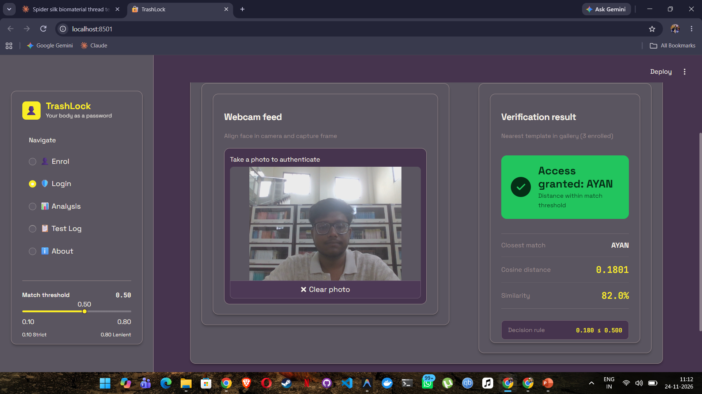
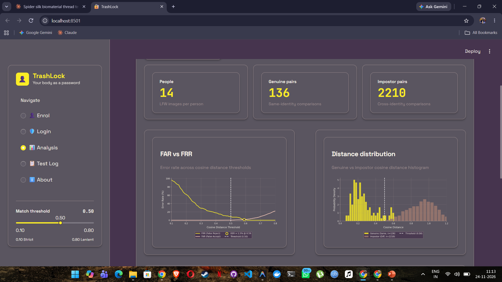
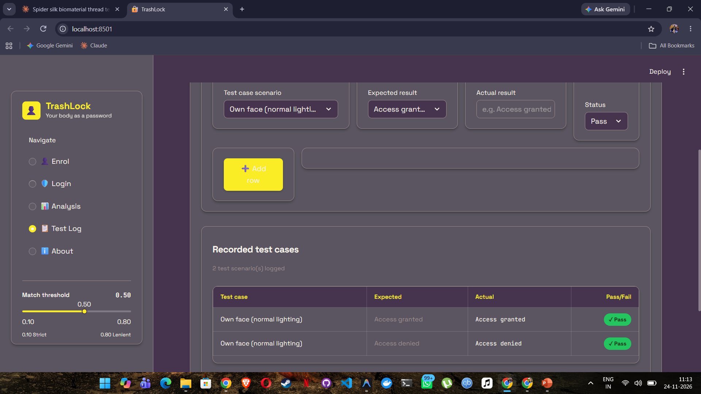
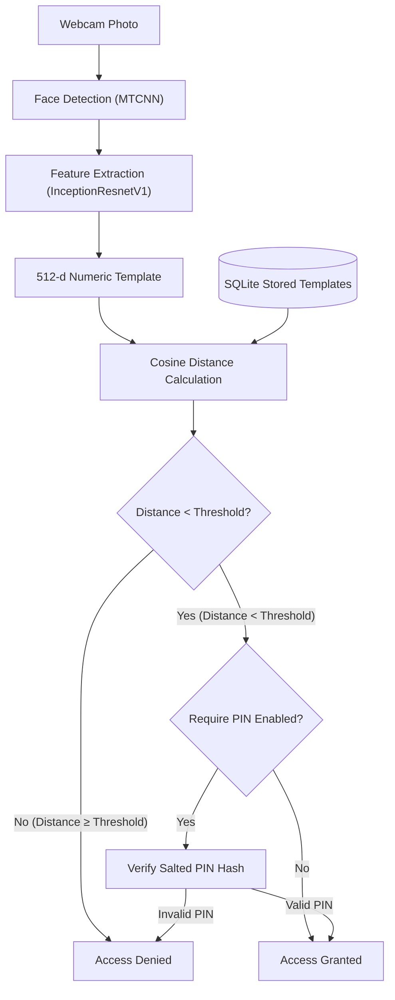
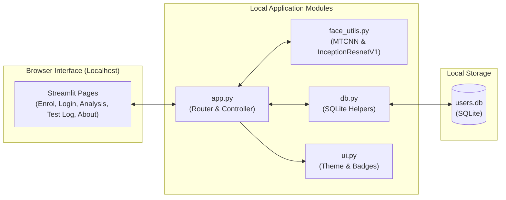

# 🔐 TrashLock

> **Your body as a password**

An educational prototype demonstrating facial biometric authentication, matching threshold trade-offs, and presentation attack logging using PyTorch and Streamlit.

[](https://www.python.org/)
[](https://streamlit.io/)
[](https://www.sqlite.org/)
[]()

---

## 💡 What is TrashLock?

TrashLock is an educational face-login demonstration where you can drag the matching threshold live and watch strangers get in or genuine users get locked out. Built to explore biometric security transparently, it avoids opaque cloud APIs and runs entirely on your local machine. The system detects faces, converts them into compact mathematical vectors, and compares them using cosine distance. It gives learners and developers hands-on intuition for how real-world biometric systems balance usability against security.

---

## ⚡ See It in 60 Seconds

1. **Enrol a face**: Open the **Enrol** page, enter a username and an optional PIN, capture 3 to 5 webcam snapshots, and save the averaged biometric template.
2. **Log in**: Navigate to the **Login** page, face the camera, and capture a photo to authenticate against enrolled templates in real time.
3. **Drag the threshold slider**: Adjust the **Match threshold** slider in the sidebar from strict (e.g., 0.30) to lenient (e.g., 0.70) to watch how the access decision immediately changes between granted and denied.
4. **Open Analysis**: Switch to the **Analysis** page, load the benchmark dataset sample, and inspect how threshold shifts affect error rates on interactive trade-off curves.

---

## 📸 Screenshots

<!-- Replace the placeholder images in docs/screenshots/ with your real screenshots -->

| Page | Preview |
|---|---|
| **Enrol** | <br>_Capture face frames and register an averaged template._ |
| **Login (Granted)** | <br>_Successful biometric match granting access._ |
| **Login (Denied)** | <br>_Impostor rejection with distance above threshold._ |
| **Analysis** | <br>_Interactive FAR/FRR trade-off curves and distance distribution histograms._ |
| **Test Log** | <br>_Documenting physical presentation attack experiments with Pass/Fail badges._ |

---

## ✨ Features

| Page / Capability | Description |
|---|---|
| **Enrol** | Captures 3 to 5 webcam samples, extracts and averages a 512-dimensional template, sets an optional fallback PIN, and lists enrolled participants with individual deletion. |
| **Login** | Live 1:N facial verification against enrolled templates using cosine distance, complete with large status badges and score breakdowns. |
| **Analysis** | Benchmarks False Accept Rate (FAR), False Reject Rate (FRR), and Equal Error Rate (EER) across genuine and impostor face pairs from a public benchmark. |
| **Test Log** | Experimental logging form and table to record presentation attack scenarios (spoofing, photos, accessories, lighting) with Pass/Fail badges and CSV export. |
| **About** | Explains core concepts (enrolment, templates, cosine distance, thresholds, error rates) and security vulnerabilities. |
| **Optional PIN Second Factor** | Fallback or two-factor verification using a 4-digit PIN stored as a salted SHA-256 hash, toggleable directly on the Login page. |

---

## 🔍 How It Works



- **Template**: A compact 512-dimensional vector of floating-point values generated by InceptionResnetV1 capturing distinctive facial geometry. Captured photos are processed in memory and never saved to disk.
- **Distance**: Cosine distance ($d = 1 - \text{cosine similarity}$) measures vector divergence on a scale from 0.0 (identical direction) to 2.0 (opposite direction).
- **Threshold**: The decision boundary ($\theta$). When the minimum distance between a probe frame and any enrolled template is below $\theta$, identity is confirmed; otherwise, access is rejected.

---

## 🧪 The Threshold Experiment

Biometric authentication is never binary; it is an operating trade-off governed by the decision threshold. The table below presents real empirical measurements obtained from our evaluation on a small subset of the public Labeled Faces in the Wild (LFW) benchmark (14 people, 136 genuine pairs, 2,210 impostor pairs):

| Threshold ($\theta$) | False Accept Rate (FAR) | False Reject Rate (FRR) | Operational Meaning |
|:---:|:---:|:---:|---|
| **0.40** | 0.05% | 17.65% | High security: nearly zero impostors breach the system, but approximately 1 in 6 genuine attempts is incorrectly rejected. |
| **0.50** (Default) | 0.23% | 8.82% | Balanced default: keeps impostor acceptance very low while maintaining genuine rejection under 10%. |
| **0.59** (EER) | 1.46% | 1.46% | Equal Error Rate: the theoretical crossover point where false acceptances and false rejections are identical. |

The default threshold is set to 0.50 because it provides a strong security bias (FAR < 0.25%) while keeping false rejection under 10% for genuine users. Note clearly that this evaluation was conducted on a small, clean benchmark subset (14 people, 136 genuine pairs, 2,210 impostor pairs), so real-world error rates would be higher under unconstrained lighting, motion blur, varied camera sensors, and demographic diversity.

---

## 🛠️ Tech Stack

| Layer | Tool / Library | Purpose |
|---|---|---|
| Language | Python (3.10+) | Application runtime and script logic |
| Interface | Streamlit (1.45.1) | Reactive web UI, camera input component, and cached evaluation data |
| Face Detection | facenet-pytorch (MTCNN, 2.6.0) | Multi-task cascaded face detection, bounding box cropping, and 160×160 alignment |
| Feature Embedding | facenet-pytorch (InceptionResnetV1, 2.6.0) | Neural network pretrained on VGGFace2 producing 512-dimensional embeddings |
| Deep Learning | PyTorch (`torch` 2.2.2, `torchvision` 0.17.2) | CPU tensor computation and model inference |
| Matching & Math | NumPy (1.26.4) & SciPy (1.13.1) | Vector algebra, cosine distance calculation, and error curve sweeps |
| Storage | SQLite (`sqlite3`) | Embedded database storing numeric templates and test logs |
| PIN Security | Python `hashlib` & `secrets` | Salted SHA-256 PIN hashing with cryptographically secure random salts |
| Visualizations | Matplotlib (3.8.4) | Styled FAR/FRR trade-off curves and distance distribution histograms |
| Benchmark Loader | scikit-learn (1.5.2) | Public LFW dataset loader (`fetch_lfw_people`) |
| Image Processing | Pillow (10.2.0) & OpenCV (`opencv-python-headless`) | In-memory frame conversion and image array manipulation |

---

## 🏛️ Architecture



Everything runs locally as a self-contained application on a single machine; no external API or separate backend server is needed.

---

## 🚀 Quick Start

### Windows (PowerShell)

```powershell
git clone https://github.com/your-username/TrashLock.git
cd TrashLock
python -m venv venv
venv\Scripts\activate
pip install -r requirements.txt
streamlit run app.py
```

### macOS / Linux

```bash
git clone https://github.com/your-username/TrashLock.git
cd TrashLock
python3 -m venv venv
source venv/bin/activate
pip install -r requirements.txt
streamlit run app.py
```

Once started, open **`http://localhost:8501`** in your browser.

> **First-run notice:** On the first run, `facenet-pytorch` automatically downloads its pretrained weights (~107 MB), and the first evaluation on the Analysis page downloads the LFW subset (~200 MB). The very first webcam match is slightly slower while PyTorch loads model weights into memory; subsequent matches run in fractions of a second.

---

## 📁 Project Structure

```
biometric-prototype/
├── .streamlit/
│   └── config.toml          # Dark theme tokens (background, primary yellow, cards)
├── docs/
│   └── screenshots/         # Interface screenshots and previews
│       └── .gitkeep
├── app.py                   # Streamlit application entry point and page routing
├── db.py                    # SQLite database schema, user CRUD, PIN hashing, test logs
├── face_utils.py            # MTCNN detection, InceptionResnetV1 embeddings, cosine distance
├── ui.py                    # Stitch design system CSS, custom cards, and status badges
├── requirements.txt         # Pinned Python package dependencies
├── README.md                # Project documentation and walkthrough
└── users.db                 # Local SQLite database (created automatically, git-ignored)
```

---

## 🔒 Privacy and Ethics

- **Mathematical templates only**: Raw webcam photos are processed entirely in memory and immediately discarded. Only 512-dimensional floating-point vectors are stored.
- **Salted PIN hashing**: Fallback PINs are never stored in plaintext. Each PIN is combined with a 32-character random salt and hashed with SHA-256.
- **Local isolation**: The database `users.db` is git-ignored and never transmitted across the network or committed to source control.
- **Informed consent**: Only enrol individuals who have explicitly agreed to participate in testing.
- **Sensitive data**: Facial features constitute personal biometric data; treat all local templates with care.

---

## ⚠️ Limitations and Roadmap

### Known Limitations
- **No liveness detection**: The current prototype cannot distinguish a live human face from a 2D photograph or a high-resolution phone screen replay.
- **Small evaluation sample**: Benchmark figures reflect a small subset of clean, frontal benchmark images.
- **Environmental sensitivity**: Harsh shadows, strong backlights, off-angle head tilts, and heavy accessories can trigger false rejections.
- **Templates stored unencrypted**: Templates in `users.db` are stored as JSON arrays rather than encrypted at rest.

### Roadmap
- [ ] Blink-based liveness detection
- [ ] Larger and more varied dataset
- [ ] Encrypted templates
- [ ] Multi-user admin view

---

## 🔧 Troubleshooting

<details>
<summary>PowerShell script execution blocked</summary>

If activating the virtual environment fails with an execution policy error on Windows, enable script execution for your user account:

```powershell
Set-ExecutionPolicy -Scope CurrentUser -ExecutionPolicy RemoteSigned
```
</details>

<details>
<summary>Port 8501 already in use</summary>

If another service is using port 8501, launch the application on an alternative port:

```powershell
streamlit run app.py --server.port 8502
```
</details>

<details>
<summary>Webcam not detected or camera access denied</summary>

Ensure your browser has granted camera access permissions to `localhost`. On Windows or macOS, verify that system privacy settings allow your browser to access the webcam.
</details>

<details>
<summary>"No face detected" error during enrolment or login</summary>

MTCNN requires clear facial features to detect and crop a face:
- Face the camera directly.
- Ensure the room has balanced front lighting and avoid strong backlights or deep shadows.
- Remove heavy sunglasses or items obscuring your eyes, nose, or mouth.
</details>

<details>
<summary>Enrolment invalidation after model changes</summary>

Embedding models project faces into unique mathematical vector spaces. If the underlying model or pretrained weights are ever changed or updated, all previously enrolled users in `users.db` must be deleted and re-enrolled because embeddings from different models are incompatible.
</details>

---

_This project is an educational prototype and is not intended for production security use._
